# Hash Table Benchmark

This is yet another benchmark for hash tables(hash maps) with different hash
functions in C++, attempting to evaluate the performance of the lookup,
insertion, deletion, iteration, etc. on different data as comprehensively as
possible.

📊 **Full results with interactive charts and per-operation analysis — run on
additional hardware (Apple M1 Max and Intel Xeon E-2388G / Rocket Lake) — are
published on the blog:
[Hash Table Benchmark](https://renzibei.com/en/hashtable-bench/).**

## Before viewing the results

If one is familiar enough with the world of hash tables, he/she will know that
even for a well-known and widely used hash table, there is a data distribution
that it's not very good at. In other words, no hash table is the fastest on all
datasets for all operations.

The best practice for selecting a hash table needs to consider the
characteristics of the data and the proportion of operations, fit the actual
needs and cooperate with the most suitable hash function.

This benchmark tries to use a concise and effective method to test the
performance of different operations of the hash table on some of the most common
data distributions. But in fact, there must be a data distribution that is very
different from the data we use for testing, and different users have different
requirements for different indicators. Therefore, the best test method is to
test in real applications.

## Methodology

### Test Items

We measure the combination of different hash tables with different hash functions.
For each combination, we measured its insert, delete, lookup (including successful
and failed lookups), and iteration performance under different data. Below is a
more detailed table of test items. Please note that in the following we will use
"hash table" or "hash map" indiscriminately to refer to the same concept.

| Index | Test items                                                              | Notes                                                                                                             |
|-------|-------------------------------------------------------------------------|-------------------------------------------------------------------------------------------------------------------|
| 1     | Insert with reserve                                                     | Call map.reserve(n) before insert n elements                                                                      |
| 2     | Insert without reserve                                                  | Insert n elements without prior reserve                                                                           |
| 3     | Erase and insert                                                        | Repeatedly do one erase after one insert, keep the map size constant                                              |
| 4     | Look up keys in the map (hit)                                           | Repeatedly look up the elements that are in the map                                                               |
| 5     | Look up keys that are not in the map (miss)                             | Repeatedly look up the elements that are not in the map                                                           |
| 6     | Look up keys with 50% probability in the map                            | Repeatedly look up the elements that have a 50% probability in the map                                            |
| 7     | Look up keys in the map with large max_load_factor (hit)                | Same as Test Item 4 except that the map is set a max_load_factor of 0.9 and rehashed before the lookup operations |
| 8     | Look up keys that are not in the map with large max_load_factor (miss)  | Same as Test Item 5 except that the map is set a max_load_factor of 0.9 and rehashed before the lookup operations |
| 9     | Look up keys with 50% probability in the map with large max_load_factor | Same as Test Item 6 except that the map is set a max_load_factor of 0.9 and rehashed before the lookup operations |
| 10    | Iterate the table                                                       | Iterate the whole table several times                                                                             |
| 11    | Heap memory size and load factor with default and large max_load_factor | Record the heap memory size and load factor when construct the map in Test Item 4, 7                              |

As you may have noticed, several of the test items are set to test the query
speed of hash tables with a larger upper limit on the load factor (the load
factor is an important data indicator to measure how full the hash table is,
max_load_factor is an API for maximum load factor in STL). This is because
each hash table may have a different expansion strategy and max_load_factor,
so even with the same number of elements, they will choose different load
factors, which will cause them to occupy different memory space. The load factor
and size of the memory space occupied greatly affects the lookup performance, so
using a hash table with a smaller max_load_factor may have worse (or better)
performance when looking up. On the other hand, a higher load factor may
lead to a higher probability of collision, thus reducing the lookup performance.

In addition, if a user wants extreme lookup time,
he/she probably needs to make the space used by the hash table as small as
possible to reduce the cache miss rate. Or, when the available size of memory
is very limited, a larger load factor may be preferred. Then one of the
things that can be done is to set a higher max_load_factor, and then rehash
(or set a large max_load_factor before the main construction process of the
table).

For each of the tests above, we tested the throughput and latency
(when the platform under test meets the conditions for the latency test). The
throughput results will be more representative, because modern software runs
on CPUs with pipelined architectures. And almost all operations will have other
instructions before and after them, which can make full use of the pipeline.
However, for some specific uses, latency data is important.
The latency measurement results here are for reference only for special needs
and have relatively large limitations.

### Dataset

All the data used in the benchmark are randomly generated, the user can choose
different seeds for the test data. We tested the performance of each hash table
at different sizes from 32 to 10^7.

The tested keys consist of 64-bit integers of different distributions and
strings of different lengths. The detailed test data is shown in the table
below.

| Index | Key Type                                           | Value Type      | Notes                                                                                                                                                                                                                                                                                                                                                                                                                                                                                                                                    |
|-------|----------------------------------------------------|-----------------|------------------------------------------------------------------------------------------------------------------------------------------------------------------------------------------------------------------------------------------------------------------------------------------------------------------------------------------------------------------------------------------------------------------------------------------------------------------------------------------------------------------------------------------|
| 1     | uint64_t with several split bits masked            | uint64_t        | The keys have such characteristics: only bits in some positions may be 1, and all other bits are 0. For test data of size n, at most ceil[log2(n)] fixed bits may be 1. e.g. If the key type is uint8_t (it is uint64_t in reality) and the test size is 7, the keys will be generated with the method `rng() & 0b10010001`. The distribution characteristics of such bits can relatively comprehensively examine whether hash tables and hash functions can handle keys that only have effective information in specific bit positions. |
| 2     | uint64_t, uniformly distributed in [0, UINT64_MAX] | uint64_t        | The keys follow a uniform distribution in the range [0, UINT64_MAX].                                                                                                                                                                                                                                                                                                                                                                                                                                                                     |
| 3     | uint64_t, bits in high position are masked out     | uint64_t        | The bits in the high position are set to 0. For test data of size n, at most ceil[log2(n)] fixed bits may be 1. For example, if the key type is uint8_t (uint64_t in reality) and the test size is 7, the keys will be generated with the method `rng() & 0b00000111`                                                                                                                                                                                                                                                                    |
| 4     | uint64_t, bits in low position are masked out      | uint64_t        | The bits in the low position are set to 0. For test data of size n, at most ceil[log2(n)] fixed bits may be 1. For example, if the key type is uint8_t (uint64_t in reality) and the test size is 7, the keys will be generated with the method `rng() & 0b11100000`                                                                                                                                                                                                                                                                     |
| 5     | uint64_t with several bits masked                  | 56 bytes struct | The keys are the same as the distribution of the data 1. The payload is a 56 bytes long struct, which makes the `sizeof(std::pair<key, value>)==64`                                                                                                                                                                                                                                                                                                                                                                                      |
| 6     | Small string with a max length of 12               | uint64_t        | The key type is a string with a maximum length of 12. Both length and characters are randomly generated. The Small String Optimization(SSO) technique may be taken by the compiler.                                                                                                                                                                                                                                                                                                                                                      |
| 7     | Small string with a fixed length of 12             | uint64_t        | The key type is a string with a fixed length of 12. The characters are randomly generated. The Small String Optimization(SSO) technique may be taken by the compiler.                                                                                                                                                                                                                                                                                                                                                                    |
| 8     | Mid string with a max length of 24                 | uint64_t        | The key type is a string with a maximum length of 24. Both length and characters are randomly generated.                                                                                                                                                                                                                                                                                                                                                                                                                                 |
| 9     | Mid string with a fixed length of 24               | uint64_t        | The key type is a string with a fixed length of 24. The characters are randomly generated.                                                                                                                                                                                                                                                                                                                                                                                                                                               |
| 10    | Large string with a max length of 64               | uint64_t        | The key type is a string with a maximum length of 64. Both length and characters are randomly generated.                                                                                                                                                                                                                                                                                                                                                                                                                                 |
| 11    | Large string with a fixed length of 64             | uint64_t        | The key type is a string with a fixed length of 64. The characters are randomly generated.                                                                                                                                                                                                                                                                                                                                                                                                                                               |

Different distributions within the range representable by uint64_t are chosen as
keys. Uniformly distributed integers in the range of uint64_t are the easiest to
generate with pseudo-random numbers, but it is rare in real situations.

If users are concerned with performance using integer keys, we strongly
recommend focusing on the results on the first dataset rather than the second
dataset (i.e. the dataset with a uniform random distribution). Because the
data from the first dataset better can examine the ability of hash tables
and hash functions to deal with more diverse patterns, while the test on 
uniform random distribution barely verifies the ability of hash tables
to handle other distributions. Moreover, in terms of the data distributions
that exist today, few keys happen to be uniformly randomly distributed over
the [0, 2^63 - 1] range.

For the string datasets, different character sets are used. For the fixed length
string, the pattern is like the first dataset, where several split bits are
masked. In other words, only the bits on in some positions may diff among the
these datasets. This pattern is aimed to test the quality of the hash function.

For the strings with variable length, a subset of the printable characters can
appear in the string.

Real data distributions are often biased. And if a combination of hash function
and hash table can only handle one distribution and cannot handle other
distributions, this combination is not robust to unknown distributions. If the
distribution of the data is known in advance, the user can pick the fastest and
most stable hash table for that data.

### Tested Hash functions and Hash maps

Below is the hash function list we tested

| Name                    | Type   | Notes                                                                                                                          | Link                                           |
| ----------------------- |--------|--------------------------------------------------------------------------------------------------------------------------------| ---------------------------------------------- |
| std::hash               | Normal | Implemented by compiler; identity hash is used for integer type in libc++ and libstdc++                                        |                                                |
| absl::hash              | Normal | Implemented by google; Use 128-bit product of multiplication and a xor-shift.                                                  | https://github.com/abseil/abseil-cpp           |
| robin_hood::hash        | Normal | For integer keys, it use xor-shift, multiplication, xor-shift; For string keys it is similar to MurmurHash                     | https://github.com/martinus/robin-hood-hashing |
| xxHash_xxh3             | Bytes  | Designed for string; We use identity hash for integer type to pass compilation; Results on integer keys will not be displayed. | https://github.com/Cyan4973/xxHash             |

The four hash functions above are the current default test set. The benchmark
also ships some extra hash functions that are kept outside the default set: seed
hash functions such as `fph::SimpleSeedHash` (which take both a key and a seed as
arguments, under `src/seed-hashes/`) and `uint128_mul::hash` (under
`src/backup-hashes/`). They were moved out of the default set to keep the test
subjects simple, but they still appear in the historical results in
[`results/show`](./results/show).

We will not show the results of hash `xxHash_xxh3` in tests on integer keys.
For the early versions of `absl::Hash`, the behavior on the arm64 platform was
different from that on the x86-64 platform, and it was poor for some datasets.
This is why `uint128_mul::hash` (which is similar to `absl::Hash` on x86-64) was
used as a comparison on arm64 in those earlier results. The newest version of
`absl::Hash` has since fixed this problem.

The following table lists the hash tables we tested, some of these hash tables
rely on a "good" hash function to work properly, which can generate hash values
that are as uniformly distributed as possible for unbalanced keys. If a hash
function that does not have such property (e.g. identity hash) is used, then
the performance of these hash tables may drop drastically. These hash tables
may have the assumption that the hash values of the keys from the dataset are
uniformly distributed in the output range. This requires the hash functions to
have the properties like uniformity or diffusion.

The implication here is that a "good" hash function tends to be more complex
than the simplest hash function (the identity hash), requiring more instructions
to complete the computation. Some hash tables do not rely on a good
hash function, may due to that they have done some extra work to ensure the
uniformity of the hash values. For such a hash table, the simpler the hash
function, the better, preferably the identity hash. So we should always compare
the combinations of hash tables and hash functions, rather than fixing the
hash function to compare the hash table, or vice versa.

Here are the hash maps we tested.

| Name                          | Require good hash function | Notes                                                                                                                  | Link                                       |
|-------------------------------|----------------------------|------------------------------------------------------------------------------------------------------------------------|--------------------------------------------|
| std::unordered_map            | No\*                       | Implemented by the stl library; May differ in libc++ and libstdc++.                                                    |                                            |
| ska::flat_hash_map            | No                         | Very fast and simple; Use robin hood hash; Memory overhead: alignof(value_type) per element; Require small load factor | https://github.com/skarupke/flat_hash_map  |
| ska::bytell_hash_map          | No                         | A little slower than ska::flat_hash_map but one byte per element memory overhead                                       | https://github.com/skarupke/flat_hash_map  |
| absl::flat_hash_map           | Yes                        | Use SIMD and metadata; Fast when looking up keys that are not in the map; One byte per element memory overhead         | https://abseil.io/about/design/swisstables |
| absl::node_hash_map           | Yes                        | Slower than absl::flat_hash_map but does not invalidate the pointer after rehash                                       | https://github.com/abseil/abseil-cpp       |
| tsl::robin_map                | Yes                        | A fast hash table using robin hood hash; Memory overhead is no less than ska::flat_hash_map                            | https://github.com/Tessil/robin-map        |
| emhash::HashMap7              | Yes                        | Fast in lookup hit operations.                                                                                         | https://github.com/ktprime/emhash          |
| emhash::hash_map8             | Yes                        | Elements in a dense array, so iteration is fast                                                                        | https://github.com/ktprime/emhash          |
| sflat::flat_hash_map          | No                         | SIMD control bytes with overflow bits; Mixes the hash value itself; Grows in steps of less than 2x | https://github.com/jclin168/sflat_hash_map |
| fph::DynamicFphMap            | No                         | A dynamic perfect hash table; Ultra-fast in lookup but slow in insert; 2~8 bits per element memory overhead            | https://github.com/renzibei/fph-table      |
| fph::MetaFphMap               | No                         | A dynamic perfect hash table using metadata; Better than fph::DynamicFphMap in the miss lookup case.                   | https://github.com/renzibei/fph-table      |
| robin_hood::unordered_flat_map | Yes                       | A table using robin hood hash;                                                                                         |                                            |
| ankerl::unordered_dense_map   | No                         | Robin hood buckets with the elements in a dense vector; Fast iteration; Mixes the hash value of a non-avalanching hash | https://github.com/martinus/unordered_dense |
| boost::unordered_flat_map     | No                         | SIMD metadata with per-group overflow bits; Mixes the hash value of a non-avalanching hash                             | https://www.boost.org/doc/libs/release/libs/unordered/ |

\* Note: For the tested libc++ and libstdc++ version, the libc++ implementation
requires a good hash function but no such requirement for libstdc++.

With a quick glance you can easily find that many hash tables listed use the
[robin hood hashing](https://cs.uwaterloo.ca/research/tr/1986/CS-86-14.pdf)
technique in the pursuit of speed.

## Build

### Requirements

OS: Linux, macOS, or Windows

Compiler: Only GCC and Clang have been tested; You may test with MSVC and
contribute to the benchmark. The compiler has to support C++17 or newer
standard.

Build Tool: CMake >= 3.10

### Steps

First, clone this repo to the machine, then update the submodules

```bash
cd hashtable-bench
git submodule update --init --recursive
```

Use CMake to make the targets

```bash
mkdir build
cd build
cmake .. -DCMAKE_BUILD_TYPE=Release # (default option: -DBENCH_ONLY_INT=OFF -DBENCH_ONLY_STRING=OFF)
make -j8
```

Use the python script provided to run all the tests in the benchmark. If you are using linux, you may change the core
affinity settings in it (which is at the beginning of that script) or use the external taskset command to set the core
affinity of the python process.

```bash
cd ../tools
python3 run_bench.py seed export_results_directory_path
```

`boost::unordered_flat_map` needs the Boost headers, which are not a submodule:
put them in `thirdparty/boost` (so that `thirdparty/boost/boost/unordered/unordered_flat_map.hpp`
exists) or install them on the system. Without them the map is left out of the build.

The results of the tests will be in the format of `csv` files. You can use the headless script
`tools/gen_charts.py` (or the jupyter notebook `tools/analyze_results.ipynb`) to parse and
generate plots of the results. `tools/plot_figs.py` draws PNG line charts like the ones
below, and `tools/summarize_csv.py` writes markdown tables.

## Features


- One can easily add new hash functions and hash maps.
- Data with different distributions, different characteristics, and different types are tested.
- Tested as many operations on hash tables as possible.
- Provides a convenient tool for visualizing test results.
- Support the hash tables with a seed hash function (which takes both a key and a seed as the function arguments) like
[Flash Perfect Hash](https://github.com/renzibei/fph-table).

## How to add a new hash function or hash table

One can follow the samples in `src/hashes/std_hash` and `src/maps/std_unordered_map`. If the new hash function or the
hash map has a repo in the GitHub, you can add it as a submodule (put in `thirdparty/`) and then use CMake `addsubmodule`
or just add the include directories.

After the new hash directory or hash map directory is added, run the CMake command to generate the build targets.

## Restrictions

### Exclusive access to resources
In our tests, almost all computer resources can be monopolized by the test
program, especially cache resources. And this is relatively rare in practical
applications. In fact, other processes and tasks may occupy part of the cache.
In practical applications users should expect a lower available cache size.

### Cold memory and warm cache
We neither did a warmup, nor did we specifically test the cold start scenario.
In our tests, we repeatedly test an operation with a range of data many times.
Therefore, when the number of operations is much greater than the amount of
data, it can be considered that most operations are accessing the warm cache.
When the number of operations is less than the number of data, most operations
are accessing cold memory. In our test, limited by the test time, when the
amount of data is small, the number of operations will be much greater than
the amount of data; and when the amount of data is large, the number of
operations will be equal to the amount of data.

### Huge test space
The size of the test space contains at least 
```
|hash table set| x |hash function set| x |data sets| x |operation set| x |hardware platform set| x |compiler set|
```
As you can see, the testable space is quite huge. Any addition to the set of hash
tables or the set of hash functions will greatly increase the testing effort.
Due to time and resource constraints, we have only explored some of the
combinations, and there are still many combinations and spaces that we have not
tested.

## Results

> A more complete write-up of earlier runs — with interactive charts and
> per-operation analysis on Apple M1 Max and Intel Xeon E-2388G — is published
> on the blog: [Hash Table Benchmark](https://renzibei.com/en/hashtable-bench/).

The figures below are from a run on an Intel Core i5-3230M in November 2026,
with six maps and `std::hash` as the hash function for all of them. The raw CSV
data is in [`results/i5-3230M-202611`](./results/i5-3230M-202611), with
markdown tables of every dataset in
[`summary.md`](./results/i5-3230M-202611/summary.md). The figures were drawn
with `tools/plot_figs.py`. The figures of the earlier run (AMD 3990X and Apple
M1 Max, early 2022, with more maps and hash functions) are still in
[`results/show`](./results/show).

For throughput data, performance is represented by the average time per
operation, at data sizes from 32 to 10^7. The shorter the time, the better.

If a test takes too long, it counts as a timeout and its time is recorded as
zero, and that data point is not plotted. With `std::hash`, which is the
identity function for integers in libstdc++, `absl::flat_hash_map` and
`emhash::hash_map8` time out on the datasets with masked integer keys: absl on
`mask_split_bits` above about 12,000 elements and on `mask_low_bits` above about
25,000; emhash8 above about 3,000 and 1,000 elements. They rely on a good hash
function, and the identity hash puts many keys in the same group or bucket.
Both work on `mask_high_bits` and on the other datasets.
`sflat::flat_hash_map`, `boost::unordered_flat_map` and
`ankerl::unordered_dense_map` mix the hash value themselves, so they work with
`std::hash` on every dataset. `ankerl::unordered_dense_map` times out in the
erase and insert test at large sizes (from 1.2 to 6 million elements, depending
on the dataset).

### Testing Platform

Intel Core i5-3230M (Ivy Bridge), 2.6 GHz base; 32 KB L1d and 256 KB L2 per
core, 3 MB L3; SSE4.2 and AVX, no AVX2 (so SIMD groups are 16 wide); 14 GiB
RAM; Ubuntu 26.04, Linux 7.0; GCC 15.2 with `-O3 -march=native`; x86-64.

Measures taken to reduce noise:

1. Each benchmark binary is pinned to one core with `taskset -c 2`, and only
one benchmark runs at a time. Nothing else runs on the machine during a run.
2. Hyper-threading is off (CPUs 0 and 2 are online).
3. Both cores use the `performance` governor and turbo boost is off
(`intel_pstate/no_turbo`), so the clock stays at about 2.5 GHz. On this CPU all
cores share one clock, and with the `powersave` governor the clock of the
benchmark core followed the load of the other core: the same code ran twice as
fast while the other core was busy. A first run in that state was thrown away.
`results/i5-3230M-202611/clk` measures the effective clock before and after
each map (logged in `logs/time_progress.log`); it stayed within 1.31 to 1.37
(iterations per ns of a dependent add loop) during the whole run.
4. Transparent huge pages are on `madvise`.

The cores are not isolated, so single data points can still be noisy. Compare
the trend over several sizes rather than one point.

Versions: `sflat::flat_hash_map` jclin168/sflat_hash_map main (aaded6f),
`absl::flat_hash_map` 20260817.0, `ankerl::unordered_dense_map` v5.3.3,
`boost::unordered_flat_map` Boost 1.92.0, `emhash::hash_map8` master (76490cd),
`std::unordered_map` libstdc++ 15.2.

### Heap memory

Heap bytes per element after `reserve(n)` and n inserts, measured with a
counting allocator. Strings longer than the small string buffer allocate
outside the map and are not counted, so the three string lengths give the same
numbers.

| n | sflat | boost | absl | ankerl | emhash8 | std::unordered_map |
|---|---|---|---|---|---|---|
| uint64 -> uint64, 1,638 | **19.7** | 20.0 | 21.2 | 22.9 | 52.1 | 32.5 |
| uint64 -> uint64, 104,857 | **19.7** | 20.0 | 21.2 | 22.9 | 52.0 | 32.2 |
| uint64 -> uint64, 1,258,291 | **19.7** | 26.7 | 28.3 | 25.2 | 34.7 | 32.5 |
| uint64 -> uint64, 10^7 | **19.7** | 26.8 | 28.5 | 25.2 | 34.9 | 32.3 |
| uint64 -> 56 bytes, 10^7 | 74.6 | 102.3 | timeout | **73.2** | timeout | 80.3 |
| string -> uint64, 10^7 | **47.1** | 64.6 | 68.8 | 49.2 | 67.1 | 64.3 |

At 10^7 uint64 -> uint64 elements this is 188 MiB for sflat, 241 MiB for
ankerl, 256 MiB for boost, 272 MiB for absl, 308 MiB for std::unordered_map and
333 MiB for emhash8. sflat keeps a load factor of 0.875 at every size because
its capacity is not limited to powers of two. The maps with power-of-two
capacities fall to a load factor of about 0.6 just past a power of two, as at
1.26 million and 10 million elements here. ankerl stores the elements in a
dense vector and only 8 bytes per bucket, so it uses the least memory for the
large 56-byte payload.

The sawtooth in Figure 1 comes from the power-of-two capacities: right after a
table has grown the memory per element is highest, and just before the next
growth it is lowest. sflat has no such steps.

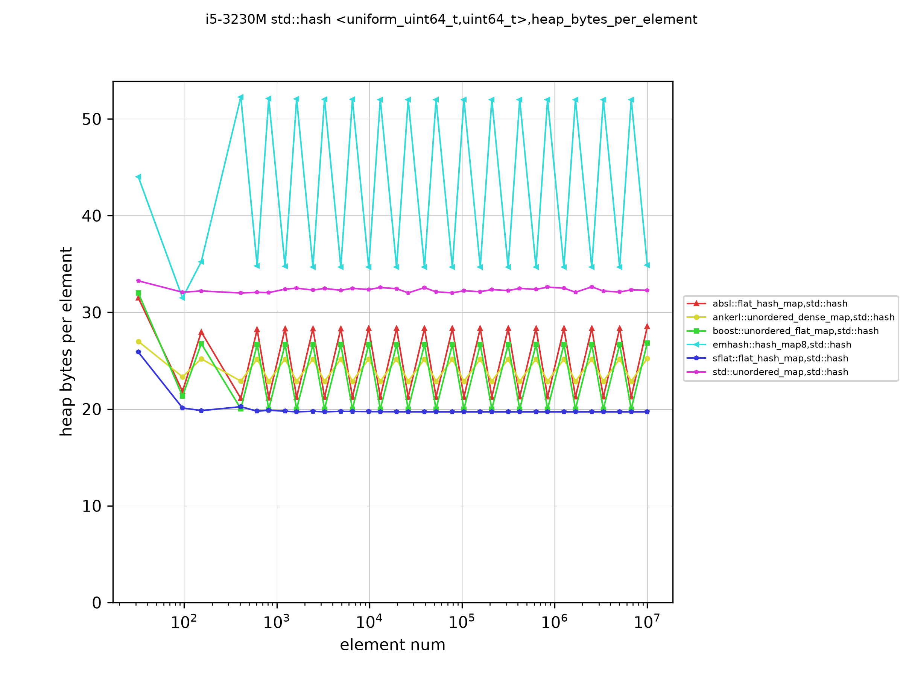

<center>Figure 1: Heap bytes per element after reserve(n) and n inserts, uniform uint64_t keys</center>

### <K,V>: <uint64_t with several split bits masked, uint64_t>

#### Look up keys in the map with large max_load_factor


<center>Figure 2: Look up keys in the map with max_load_factor 0.9</center>

#### Look up keys in the map with default max_load_factor

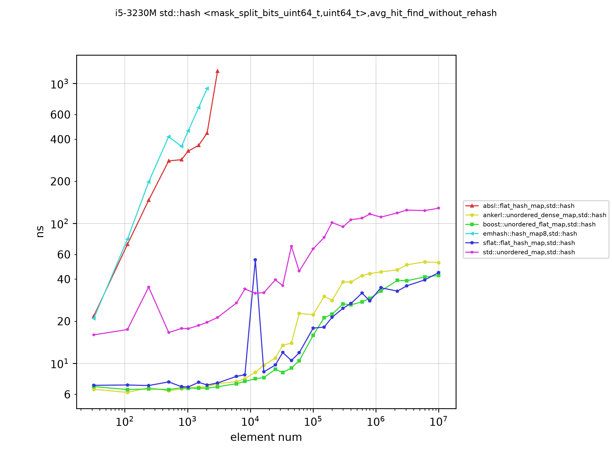

<center>Figure 3: Look up keys in the map with the default max_load_factor</center>

#### Look up keys that are not in the map

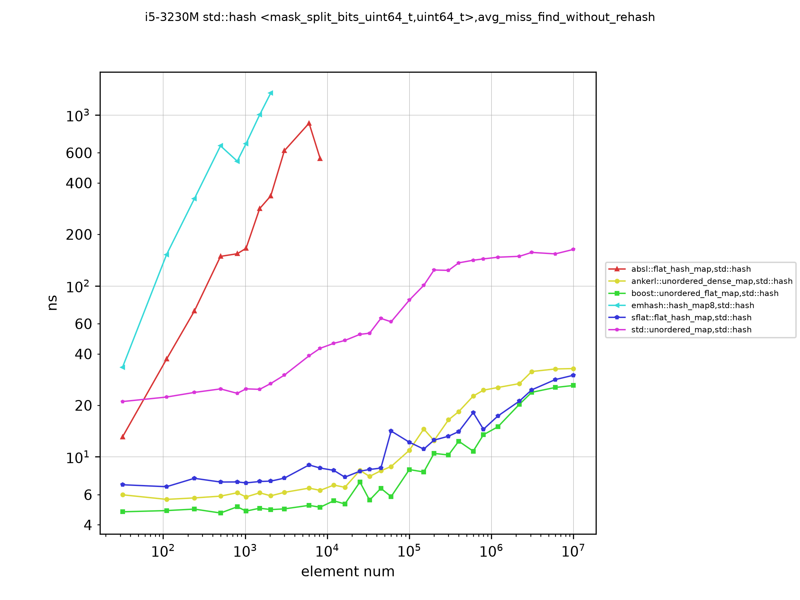

<center>Figure 4: Look up keys that are not in the map, default max_load_factor</center>

#### Analysis of lookup integer keys

The lookup speed depends mostly on where the table fits in the cache. With 16
byte elements, a table of about 2,000 elements fits in the 32 KB L1 data cache,
about 16,000 in the 256 KB L2 and about 190,000 in the 3 MB L3. Past that, most
lookups wait for DRAM, and the cost per lookup rises by several times between
10^4 and 10^6 elements in the figures.

`boost::unordered_flat_map`, `ankerl::unordered_dense_map` and
`sflat::flat_hash_map` are within a few percent of each other on hits at 1,024
elements (6.6, 6.7 and 6.8 ns), and boost is the fastest at most larger sizes
with the default load factor: 15.9 ns against 17.8 ns for sflat and 22.3 ns for
ankerl at 10^5 elements, and 42.5, 44.5 and 52.5 ns at 10^7. With
`max_load_factor(0.9)` sflat is the fastest on hits from 10^5 elements on (41.5
ns against 47.1 ns for boost at 10^7). On the uniform dataset `emhash::hash_map8`
is the fastest on hits up to a few thousand elements, and at 10^5 to 10^7
elements absl, boost and sflat are within 10% of each other.

For keys that are not in the map, boost is the fastest at most sizes, by 15% to
45% over sflat (26.1 ns against 30.0 ns at 10^7, 8.4 ns against 12.2 ns at
10^5), and ankerl is slower than both. `std::unordered_map` is 3 to 6 times
slower than the fastest flat map on every lookup past the L2 cache, because each
lookup follows a pointer to a node.

#### Insert with reserve

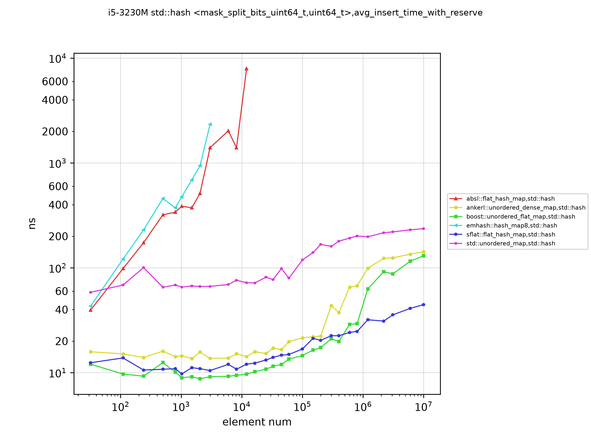

<center>Figure 5: Insert keys into the map after reserve</center>

Up to about 10^5 elements boost is the fastest (9.0 ns against 9.7 ns for sflat
at 1,024 elements, 14.6 ns against 16.8 ns at 10^5). From about 10^6 elements on,
sflat inserts the fastest on the integer datasets (except `mask_high_bits`,
where emhash8 is faster at 10^7), and the gap to the others grows with the size:
at 10^7 elements it takes 44.6 ns per insert, against 130 ns for boost, 142 ns
for ankerl and 236 ns for `std::unordered_map`. Without a prior `reserve`, the
order is the same at large sizes (64 ns against 136 ns for boost at 10^7), and
ankerl and boost are the fastest at small sizes.

#### Erase and insert

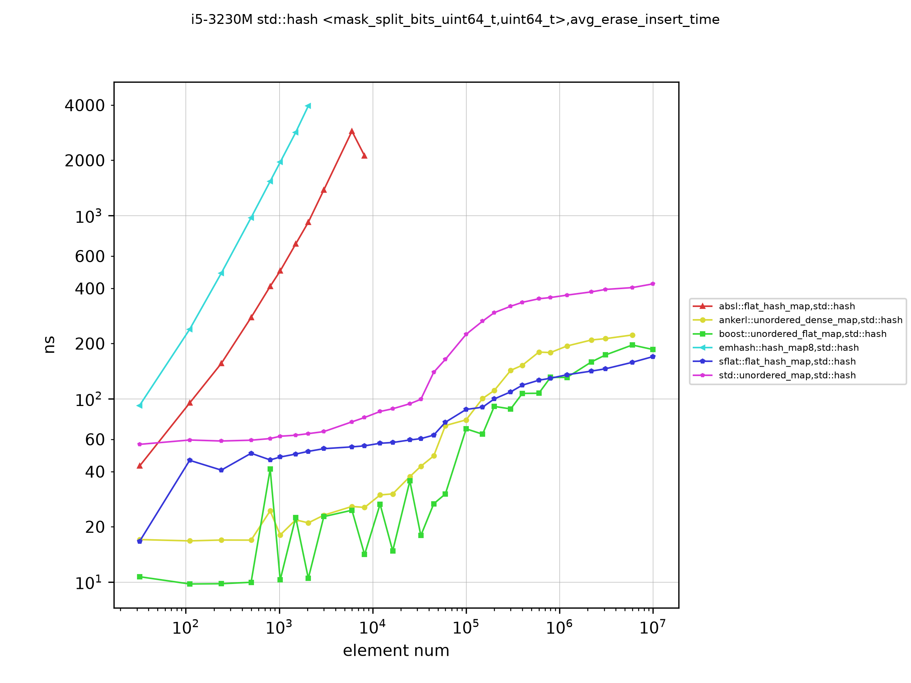

<center>Figure 6: Erase a random key and insert a new one, at a fixed size</center>

The keys to erase are chosen at random with equal probability; real workloads
often erase recent keys more often, so this test depends on the data more than
the others.

`boost::unordered_flat_map` is the fastest up to about 10^6 elements, by a wide
margin on small tables (10.2 ns against 48.0 ns for sflat at 1,024 elements,
68.5 ns against 87.3 ns at 10^5). sflat works at a 0.875 load factor and leaves a
tombstone when it erases from a full group, so it has to rebuild the table in
place now and then. At about 10^6 elements the two are level (131 ns for boost,
135 ns for sflat), and at 10^7 sflat is slightly ahead on integer keys (170 ns
against 185 ns for boost on this dataset, 165 ns against 188 ns on the uniform
dataset, where absl takes 167 ns). On string keys sflat is slower than the
fastest map in every size band, by 1.4 to 2 times on average (see below).

#### Iterate

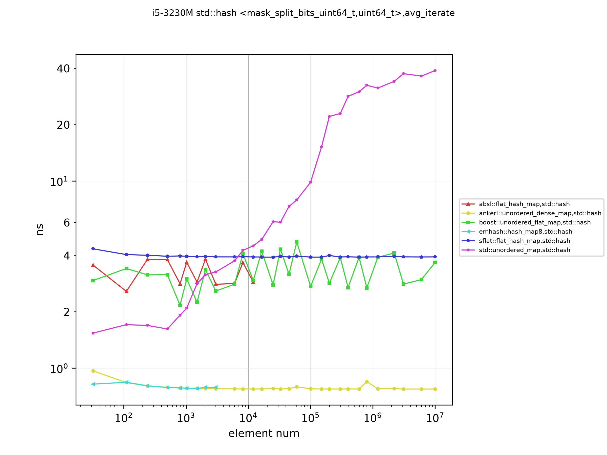

<center>Figure 7: Iterate the table</center>

`ankerl::unordered_dense_map` and `emhash::hash_map8` keep the elements in a
dense array, so iteration takes 0.8 ns per element at every size. The
SwissTable-style maps (sflat, boost, absl) scan the control bytes and skip empty
slots, at 3 to 9 ns per element. `std::unordered_map` follows the node list: it
is fast while the nodes are in the cache (2 ns at 1,024 elements), and the
slowest once they are not (39 ns at 10^7).

### <K,V>: <uint64_t with several split bits masked, 56 bytes struct>

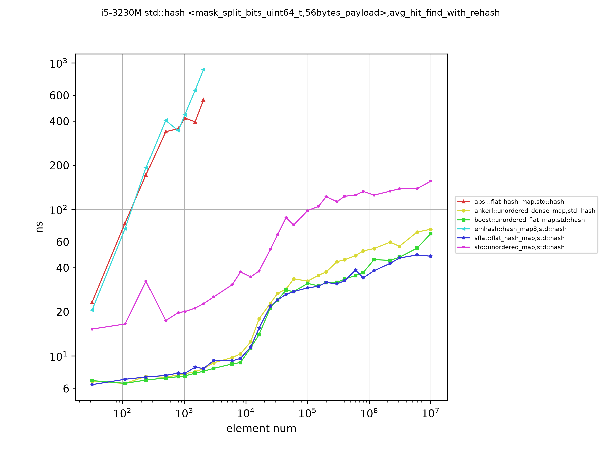

<center>Figure 8: Look up keys in the map with max_load_factor 0.9, 64-byte elements</center>

With a 64-byte element each lookup touches a whole cache line, so the cache
levels show up at smaller sizes. Here sflat is the fastest on hits from 10^5
elements on, and on inserts from 10^5 on; boost is the fastest on misses
(30 ns against 36 ns for sflat at 10^7) and on small tables.

### <K,V>: <Small string with max length of 12, uint64_t>

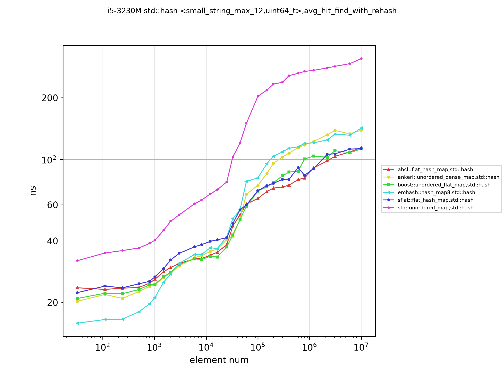

<center>Figure 9: Look up keys in the map with max_load_factor 0.9</center>

### <K,V>: <Small string with fixed length of 12, uint64_t>

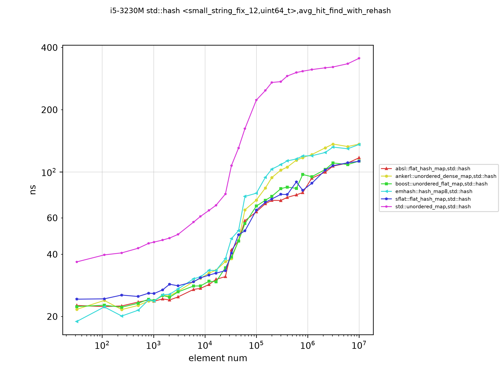

<center>Figure 10: Look up keys in the map with max_load_factor 0.9</center>

### <K,V>: <Mid string with max length of 24, uint64_t>

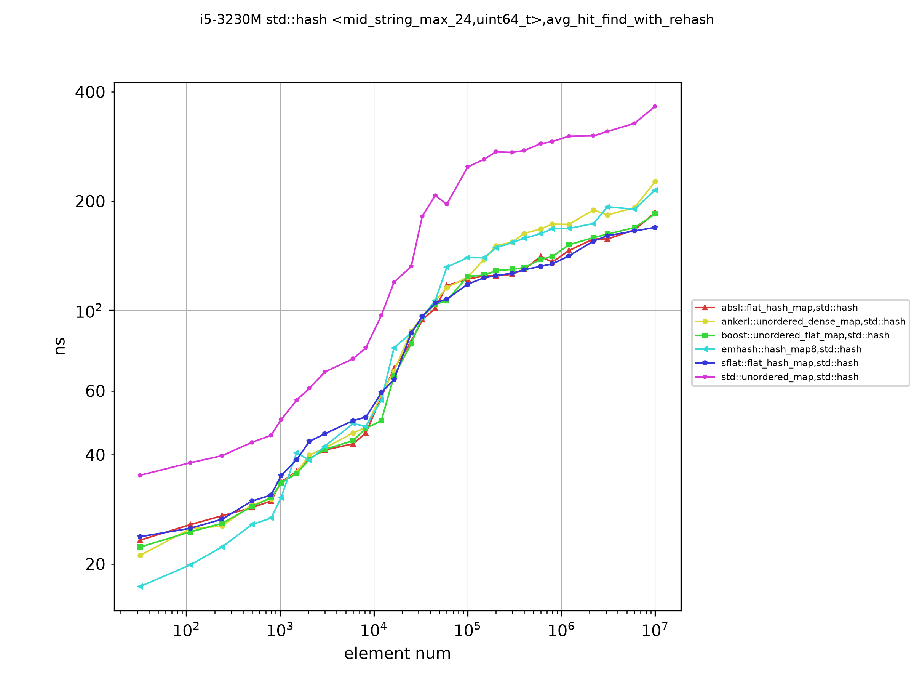

<center>Figure 11: Look up keys in the map with max_load_factor 0.9</center>

### <K,V>: <Large string with fixed length of 64, uint64_t>

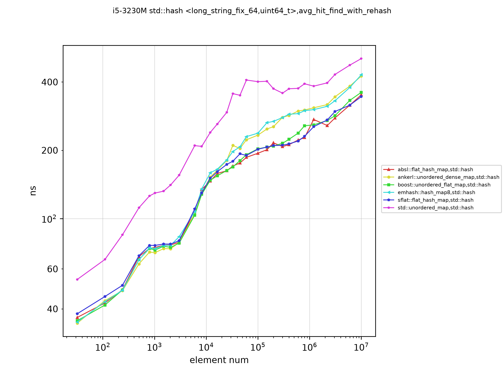

<center>Figure 12: Look up keys in the map with max_load_factor 0.9</center>

#### Analysis of string keys

With string keys, hashing and comparing the string take a large share of each
operation, and all maps use the same `std::hash<std::string>`. The flat maps
are therefore close to each other on hits: over the six string datasets,
sflat is on average 1% to 15% slower than the fastest flat map on hits (15% below
5,000 elements, 1% to 3% above 300,000), and at 10^6 and 10^7 elements it is
the fastest on hits on most of the datasets (for example 112 ns at 10^7 with
fixed 12-byte keys, and 343 ns with fixed 64-byte keys, against 346 ns for absl and 365 ns for boost).
On misses sflat is 9% to 34% slower than the fastest map.

Inserts and erases differ more. Over the six datasets sflat is on average 1.3
to 1.65 times slower than the fastest flat map on inserts with `reserve`, 1.6 to
2 times on inserts without it, and 1.4 to 2 times on erase and insert. boost is
the fastest on most small and mid sizes, and ankerl on large ones: at 10^7
elements with fixed 12-byte keys an insert takes 153 ns in sflat and 115 ns in
ankerl, and an erase and insert takes 834 ns in sflat and 432 ns in boost with
fixed 64-byte keys. One possible reason is that an in-place rebuild of sflat hashes
every string again; this was not tested here.

The lengths of the variable-length strings are roughly uniform between about 1
and the maximum length (there are fewer distinct short strings, so longer
strings are somewhat more common). Real strings — names, words, identifiers,
encodings — have very different length distributions, so test with your own
data when string keys matter.

### <K,V>: <uint64_t with bits in low position masked out, uint64_t>

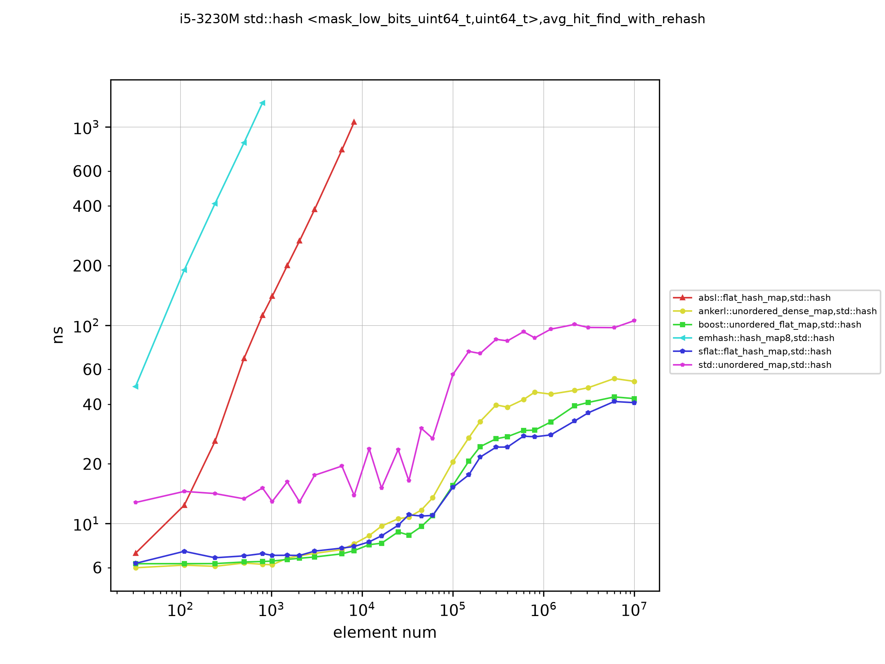

<center>Figure 13: Look up keys in the map with max_load_factor 0.9</center>

The keys of this dataset differ only in their high bits. With `std::hash`, a
table that takes the bucket from the low bits of the hash puts all of them in
the same place, which is why absl and emhash8 time out here. boost, ankerl and
sflat mix the hash and are not affected: boost and ankerl are the fastest on
small tables, and sflat on hits and inserts from about 10^6 elements on (41 ns
per hit and 44 ns per insert at 10^7).

## Conclusion

The performance is different for different key types, operations, data sizes,
data distributions and machines. The results here are for one older x86-64
laptop CPU, with one hash function, on synthetic data. Use them to pick a few
candidates, then test them with your own data.

From this run:

- With `std::hash` (identity for integers), use a map that mixes the hash
itself: `sflat::flat_hash_map`, `boost::unordered_flat_map` or
`ankerl::unordered_dense_map`. `absl::flat_hash_map` and `emhash::hash_map8`
need a better hash function for keys that are not uniformly distributed.
- `boost::unordered_flat_map` is the best all-round map here. Up to about 10^5
elements it is the fastest or close to it on almost every operation, and much
faster than the others at erase and insert; it is also the fastest on lookup
misses at most sizes.
- For large tables of integer keys, `sflat::flat_hash_map` inserts 2 to 3 times
faster than boost and ankerl, is level with boost on lookup hits, and uses the least
memory: 19.7 bytes per element for 16-byte elements, against 25 to 35 bytes for
the other open-addressing maps. Its lookup misses are 10% to 45% behind boost.
- With string keys sflat is close to the best on lookup hits but slower on
inserts and erases than boost and ankerl, by 1.3 to 2 times on average.
- If iteration speed matters most, the dense-array maps
(`ankerl::unordered_dense_map`, `emhash::hash_map8`) iterate about 4 to 10 times
faster than the others, and ankerl uses the least memory for large elements.
- `std::unordered_map` is 3 to 6 times slower than the flat maps past the
cache sizes, but it keeps references to elements valid across rehashes.

There are many more figures than are shown here. The CSV data is in the
`results` directory, and `tools/plot_figs.py` or `tools/summarize_csv.py` can
plot or tabulate any of it.
